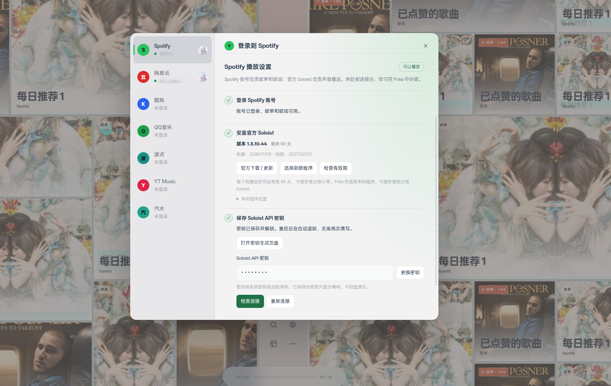

# Spotify Soloist 播放

Spotify 账号登录负责读取歌单和歌词。桌面版使用 Spotify 官方 Soloist 播放声音；Soloist 需要单独的 API 密钥和 Spotify Connect 设备配对。

## 配置

1. 在主页打开“登录在线平台”，选择 Spotify，用浏览器授权账号登录。
2. 点击“官方下载 / 更新”，从 [Spotify 官方页面](https://developer.spotify.com/documentation/soloist/reference/downloads-and-updates)下载适合本机的 Soloist 构建。
3. 解压下载包。点击“选择已下载的程序”，选择 `soloist`；Windows 选择 `soloist.exe`。
4. 点击“打开密钥生成页面”，用 Premium 账号打开开发者控制台中的 Spotify Soloist API Key 页面，生成密钥。
5. 在 Folia 中填写密钥，点击“保存密钥并启动”。
6. 在同一局域网的 Spotify 应用中打开设备列表，选择 `Folia Audio`。
7. 回到 Folia 播放 Spotify 歌曲。

命令面板中的“Spotify 播放设置”也会打开同一页。

页面显示加密密钥的保存和解锁状态。已保存的密钥只显示掩码。系统密钥库锁定时，密钥文件会保留；解锁系统密钥库后点击“重新连接”。Linux 的 `basic_text` 后端不能安全保存密钥，因此不会被用于保存。

以下截图来自已实际播放验证的本机补丁。

## 更新

每个 Soloist 构建自发布起有效 90 天。页面读取本机程序的 `--version` 输出，计算到期日期；剩余 14 天开始提醒。过期程序不能启动。无法识别构建日期时，页面显示有效期待确认。

Folia 不分发 Soloist 压缩包或二进制文件。用户需要从 Spotify 官方下载新版，解压后重新选择程序。更新会保留加密密钥和设备配对目录。

## 播放与限制

Soloist 直接向操作系统输出声音。Folia 使用静音媒体维护现有的播放控件和歌词时间轴，并按 Soloist 的播放位置校正时间。静音媒体不会写入歌曲缓存。静音时间轴支持最长 3 小时的歌曲；更长的歌曲会明确报错，不会截断后继续播放。Folia 的均衡器、Automix 和依赖实际音频频谱的动效暂不处理这路声音。音频格式由 Soloist 选择，Folia 不提供无损或高解析度的保证。

控制接口只监听 `127.0.0.1:9090`。密钥只在主进程保存和读取，不会随状态接口返回渲染进程。

本机补丁的实际播放验证环境为 CachyOS Linux x86_64、KDE Plasma 6.8.2、Folia 0.7.25。其他桌面环境、Windows、macOS 和其他架构尚未验证。

## 实现来源

播放适配参考 [Duckey86/folia-major-spotify-aeskey-fix](https://github.com/Duckey86/folia-major-spotify-aeskey-fix)，沿用 AGPL-3.0 许可证。本改动增加本机程序选择、系统密钥库保存、构建有效期检查和登录页引导。

官方说明见 [Soloist 入门指南](https://developer.spotify.com/documentation/soloist/tutorials/getting-started)。原 librespot 音频密钥获取失败的相关报告见 [#754](https://github.com/chthollyphile/folia-major/issues/754)。
